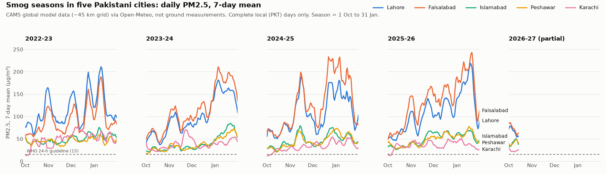
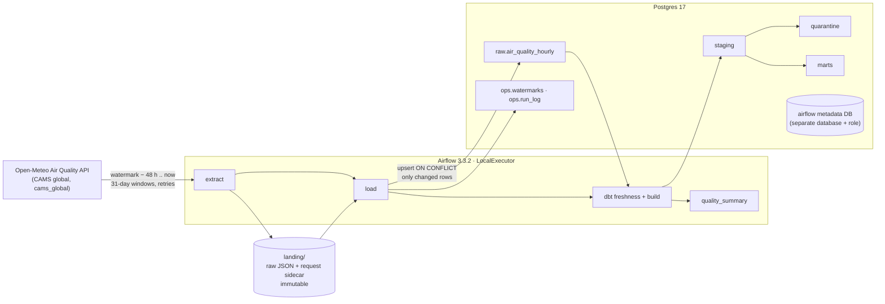

# air-quality-pipeline

[](https://github.com/chtanzeel/air-quality-pipeline/actions/workflows/ci.yml)

A scheduled pipeline that pulls hourly air quality data for five Pakistani cities from a public
API, loads it **incrementally** into Postgres, models it with **dbt** and runs on **Airflow**.
It all starts with one `docker compose up`.

It's a companion to [flight-lakehouse](https://github.com/chtanzeel/flight-lakehouse) (Spark,
Delta Lake, batch medallion) and covers what that one doesn't: orchestration, incremental loads
with watermarks, API ingestion, dbt and Docker.

> **What the data is.** These are **CAMS global atmospheric composition forecasts**: output of
> the Copernicus atmospheric model on a ~45 km grid, served by the
> [Open-Meteo Air Quality API](https://open-meteo.com/en/docs/air-quality-api). They are **model
> values for a grid cell, not ground-station readings**, and they are not street-level exposure.
> See [Limitations](#limitations).

<picture>
  <source media="(prefers-color-scheme: dark)" srcset="docs/pm25_smog_seasons_dark.png">
  
</picture>

## Results from real runs

All numbers below come from runs on 2026-10-14 (Windows 11, Docker Desktop with WSL2, 3.8 GiB
for Docker). The raw run notes are in [docs/run_notes.md](docs/run_notes.md).

| | |
|---|---|
| Coverage at backfill time | 5 cities, **2022-08-04T00:00Z to 2026-10-14T15:00Z**, every hour present (36,784 hours per city) |
| Full backfill (Airflow) | **183,920 rows** from 250 API responses in **3 min 44 s** (250 mapped tasks, 0 retries, dbt build included) |
| Re-running a backfilled window | 2024-25 season (14,760 rows): **0 inserted, 0 updated**; row count and content checksum identical before and after |
| Daily incremental run | fetches only *watermark − 48 h* to now: 360 rows, **5 inserted** (the new hour per city), 320 unchanged |
| Quarantined | **561 rows (0.31%)**, with reasons (below); the threshold is 1% |
| dbt | `dbt build` PASS=66: 2 seeds, 7 models, 53 data tests, 4 unit tests |
| pytest | **53 passed** (unit, loader on real Postgres, DAG integrity) |
| Footprint | about 0.8 GiB RAM at idle (API server, scheduler, DAG processor, Postgres) |

## Findings

From `marts.mart_smog_season_summary` and `marts.fct_air_quality_daily`. Smog season = 1 October
to 31 January, local time (PKT). These describe the CAMS model's view of each city's grid cell.

1. **Faisalabad has overtaken Lahore.** Lahore had the highest season-mean PM2.5 in 2022-23
   (117.5 vs 94.7 µg/m³). Every season since, Faisalabad has ranked first, and its mean rose
   three seasons in a row: 116.3 → 129.7 → 136.2 µg/m³ (**+44%** on 2022-23). Lahore stayed
   roughly flat (100.6 → 109.0 → 110.9). Faisalabad also logged 381 *Hazardous* hours (US AQI
   > 300) in 2024-25.
2. **Lahore's worst week was 13–19 January 2026**, with a 7-day mean PM2.5 of **219 µg/m³**,
   about 15 times the WHO 24-hour guideline (15 µg/m³). Faisalabad's worst week came at the
   same time (15–21 Jan 2026, 243 µg/m³).
3. **Clean days barely exist in smog season.** Across the four complete seasons, the daily mean
   PM2.5 was above the WHO 24-hour guideline on **2,422 of 2,434 city-days (99.5%)**. That
   includes coastal Karachi, the cleanest of the five (season means 34–50 µg/m³).

The current season (2026-27) is flagged `is_partial`, and the mart doesn't compute a
season-on-season change for it, because two weeks of October against a full season would
mostly measure the calendar.

## Architecture



| Layer | What happens |
|---|---|
| **Extract** ([client.py](src/air_quality/client.py), [extract.py](src/air_quality/extract.py)) | One request per city and window (≤31 days). Timeouts; exponential backoff on 429/5xx/network errors (honours `Retry-After`); no retry on 400, and the API's `reason` is surfaced. Every response is saved byte for byte to `landing/<city_id>/<start>_<end>_<fetched_at>.json`, with a `.params.json` sidecar holding the request and fetch time. Files are never overwritten. |
| **Load** ([load.py](src/air_quality/load.py)) | Flattens to one row per city and UTC hour, drops hours after the file's fetch time (forecasts) and hours where every value is null, then COPYs into a temp table and upserts into `raw.air_quality_hourly` (PK `city_id, measured_at`) with lineage columns `_source_file`, `_loaded_at`, `_batch_id`. The upsert and the watermark update share one transaction. |
| **Incremental** ([watermarks.py](src/air_quality/watermarks.py)) | `ops.watermarks` holds the last loaded hour per city. `ops.run_log` gets one row per run (status, window, fetched/inserted/updated/unchanged/dropped, duration, error), failures included. |
| **Transform** ([dbt/](dbt/)) | `stg_air_quality_hourly_all` types and renames each row, derives local date, `smog_season` and `is_native_step`, and gives it a `quarantine_reason`. Clean rows go to `stg_air_quality_hourly` and the rest to `quarantine_air_quality_hourly`. Marts: `dim_city`, `fct_air_quality_daily`, `fct_aqi_band_hours`, `mart_smog_season_summary`. |
| **Orchestrate** ([dags/](dags/)) | `air_quality_daily` (01:30 UTC, `catchup=False`) and `air_quality_backfill` (manual, `start_date`/`end_date`/`cities` params). |

## Design decisions

**Watermark plus lookback.** Each run requests *last loaded hour − 48 h* up to today, widened to
whole days because the API takes dates. Model values for recent hours can be revised upstream,
so re-fetching the last two days and upserting picks up corrections without a full reload. The
cost is small (72 extra hours per city per day), and `ops.run_log` shows what each run actually
changed. A first run with no watermark starts at `AQ_START_DATE` (2022-08-04, the first hour of
CAMS global data on Open-Meteo; the brief's 2022-08-01 returns nulls). Watermarks only move
forward, so a backfill of old data never rewinds the daily DAG.

**Idempotency, end to end.**
- Landing files are immutable, and replaying them (`aq replay landing/`) rebuilds `raw` exactly.
  The loader orders files by fetch time, so when files overlap the newest fetch wins.
- The upsert's `DO UPDATE ... WHERE (old values) IS DISTINCT FROM (new values)` rewrites a row
  only if a value changed. A re-run reports *unchanged* rather than *updated* and leaves
  lineage alone.
- Future hours are cut at the file's own fetch time, not "now". Otherwise replaying an old file
  would load its stale forecasts as if they were real values.

**Quarantine, don't drop.** Rows that fail a check stay visible in
`quarantine.quarantine_air_quality_hourly`, with the reason. The build fails if their share
exceeds 1%, since that would mean something upstream changed. On the real data it caught:

| Reason | Rows | What it was |
|---|---|---|
| upstream incident | 300 | **2022-12-13 12:00Z to 12-15 23:00Z: all five cities at once** report PM2.5 < 2 µg/m³, NO₂ and dust 0, flat ozone, in the middle of smog season. An upstream model dropout, not weather. |
| us_aqi affected by upstream incident | 120 | The next 24 h: concentrations recover, but US AQI is a rolling mean of up to 24 h, so it's still distorted. |
| negative ozone / NO₂ | 135 | Aug–Sep 2022 only, and only on interpolated hours, down to −12 µg/m³. From Oct 2022 ozone bottoms out at exactly 0, which suggests the earliest archive wasn't clamped after interpolation. That's an inference from the data, not documented. |
| pm2_5 exceeds pm10 | 6 | Islamabad, 2023-12-15 00–05Z. Physically impossible (PM2.5 is part of PM10), so the model output is inconsistent. |

The dropout passed every per-row check, so it's handled explicitly. It's listed in
[`seeds/upstream_incidents.csv`](dbt/seeds/upstream_incidents.csv), and a test
(`assert_no_unlisted_upstream_dropouts`) fails the build if another hour appears where four or
more cities drop to near zero at once and nobody has reviewed it. On the full history that rule
matches exactly those 60 hours.

**LocalExecutor, not Celery.** One machine and one queue of small tasks doesn't need Redis and
workers. The compose file is the official Airflow 3.3.2 one, trimmed: no Redis, Celery worker,
Flower or triggerer (nothing here is deferrable), and parallelism of 4. It runs in about 0.8 GiB
at idle. The Airflow metadata DB is a separate database with its own role on the same Postgres
server, and the warehouse role can't connect to it (there's a test for that).

**Chunked backfill as mapped tasks.** The backfill DAG plans one chunk per city and 31-day window
(250 for full history). Each chunk extracts and loads straight away as its own retryable task,
with at most three at once to keep load on the free API modest. A failure retries one chunk,
not the whole history. `airflow dags backfill` doesn't fit here, because the daily DAG works out
its own window from the watermark rather than from the logical date.

**Smaller choices.**
- **dbt version:** dbt Core 1.12 with dbt-postgres. dbt's v2 (the Fusion engine) is a separate
  product with its own licence, and its install page doesn't confirm Postgres support.
- **dbt in its own virtualenv:** inside the Airflow image, because its pins conflict with
  Airflow's.
- **Local days:** days and seasons use Pakistan local time (UTC+5). Storage stays UTC.
- **dbt tests:** written as small in-repo generic tests rather than packages, so CI needs no
  `dbt deps`.

## How to run

Needs Docker with about 4 GB of memory available.

```bash
git clone https://github.com/chtanzeel/air-quality-pipeline.git
cd air-quality-pipeline
cp .env.example .env
docker compose up -d          # first run builds the image (a few minutes)
```

Open **http://localhost:8080** and log in as `airflow` / `airflow`, the defaults in `.env`.

1. Trigger **`air_quality_backfill`**. With default params it loads everything from 2022-08-04
   (about 4 minutes). For a narrower run use e.g. `{"start_date": "2025-10-01", "end_date": "2026-01-31"}`.
2. Unpause **`air_quality_daily`** to keep it current. It runs at 01:30 UTC.

The warehouse is Postgres on `localhost:5432`, user and password `warehouse` /
`warehouse_local_only`. Look at `marts.*`, `quarantine.*` and `ops.run_log`.

**Without Airflow** (local Python 3.10+ against the same Postgres):

```bash
python -m venv .venv && source .venv/bin/activate      # Windows: .venv\Scripts\activate
pip install -e ".[dev,dbt,docs]"
docker compose up -d --wait postgres
aq backfill --start 2026-10-01 --end 2026-10-07        # or: aq run (incremental)
aq status                                              # rows, watermarks, recent runs
aq dbt build                                           # dbt with this repo's project and .env
pytest                                                 # DAG tests skip here; they run in Docker/CI
docker compose run --rm airflow-cli pytest tests/test_dags.py
```

### Windows notes

This was built and run on Windows 11 with Docker Desktop (WSL2 backend).

- **Line endings.** [.gitattributes](.gitattributes) forces LF for every file. Git's default
  `core.autocrlf=true` would otherwise check scripts out with CRLF, which breaks container
  entrypoints such as `sql/init/01_create_databases.sh`.
- **`make` is optional.** The [Makefile](Makefile) is a shortcut for Linux, macOS and CI; every
  target is a plain command you can run directly.
- **Git Bash path conversion.** It rewrites container paths in `docker ... -v` arguments
  (`/tmp/x` becomes `C:/Program Files/Git/tmp/x`). Prefix with `MSYS_NO_PATHCONV=1` or use
  PowerShell.
- **Airflow doesn't run natively on Windows.** The DAG tests skip locally and run inside the
  image (`docker compose run --rm airflow-cli pytest tests/test_dags.py`) and in CI.
- **Port 5432** must be free. Change `WAREHOUSE_PORT` in `.env` if you already run Postgres.

## Testing and CI

- **pytest (53).**
  - Unit tests on saved real API responses: window chunking, retries (429 then 200, 5xx backoff,
    `Retry-After`, a 400 that is not retried and surfaces the reason), future-hour and all-null
    dropping, watermark and lookback windows, flattening and schema drift.
  - Loader tests on a real Postgres scratch database: re-loading a file changes nothing,
    overlapping windows, revisions, replay order, a forward-only watermark, and failed runs
    recorded in the run log.
  - DAG integrity: imports, no cycles, task order, retries and timeouts on every task.
- **dbt (66 nodes).**
  - Data tests: unique `(city_id, measured_at)`, not-null, accepted ranges, relationships to
    `dim_city`, the quarantine share threshold, and the dropout detector.
  - Four unit tests: season boundaries at the UTC/local day edge, quarantine reasons, AQI band
    edges (50/51, 100/101, ...), and the 20-of-24-hours completeness rule.
  - Source freshness runs in the daily DAG (warn after 30 h, error after 54 h).
  - I checked by hand that the quarantine threshold, freshness and DAG tests actually fail on
    bad input (see run notes).
- **[GitHub Actions](.github/workflows/ci.yml).**
  - ruff lint and format check.
  - pytest against Postgres started from the same compose file and init script.
  - `dbt build` on committed real landing files (840 rows).
  - DAG integrity with Airflow 3.3.2 installed from its constraints file.
  - CI never calls the live API.

## Limitations

- **Model data, not measurements.** CAMS values are grid-cell averages from an atmospheric model
  with data assimilation. They can differ substantially from ground monitors, especially for
  local urban sources. The column is named `measured_at` (as the original spec asked), but it is
  the hour the model value is valid for.
- **~45 km grid.** Each city is one grid cell (e.g. Lahore resolves to 31.5°N, 74.4°E). Nothing
  here describes neighbourhood-level differences.
- **3-hourly native resolution.** CAMS global steps are 3-hourly. The API returns every hour, and
  the in-between hours are interpolated: smoothly, not linearly, sometimes overshooting
  ([docs/probe_findings.md](docs/probe_findings.md)). `is_native_step` marks the native hours,
  and `fct_air_quality_daily.native_steps_present` counts them.
- **Partial current season.** 2026-27 has only data up to the last run, and is flagged
  `is_partial`.
- **US AQI** comes from Open-Meteo, computed from rolling means (PM 24 h). It is null for the
  first day of coverage, and it lags any sudden change.
- **The past is a model's past.** Upstream revisions are only picked up inside the 48-hour
  lookback. Older hours keep the value from when they were loaded.

## Attribution

- **Air quality data:** Copernicus Atmosphere Monitoring Service (CAMS),
  *CAMS global atmospheric composition forecasts*,
  [doi:10.24381/04a0b097](https://doi.org/10.24381/04a0b097), licensed CC BY. Contains modified
  Copernicus Atmosphere Monitoring Service information (2022–2026). Values are interpolated
  and resampled by Open-Meteo, then cleaned and aggregated here. Neither the European Commission
  nor ECMWF is responsible for any use of this information.
- **API:** [Open-Meteo](https://open-meteo.com/), used under its free non-commercial terms;
  data under CC BY 4.0. Zippenfenig, P. (2023). *Open-Meteo.com Weather API* [Computer
  software]. Zenodo. https://doi.org/10.5281/ZENODO.7970649
- The Open-Meteo air-quality docs page lists a citation for *CAMS European* ENSEMBLE data. This
  project uses the CAMS **global** product (`domains=cams_global`; Pakistan is outside the
  European domain), so the global dataset is cited above instead.

## Next steps

- **Ground truth.** Compare against ground monitors for Lahore (e.g. OpenAQ) to measure the
  model's bias, rather than only describing the model.
- **Fire signal.** Add NASA FIRMS fire counts for Punjab to separate crop-burning episodes from
  winter inversions.
- **Alerting.** Send failed runs, a stale source or a new upstream incident somewhere (Slack or
  email), not just the run log.
- **dbt incremental models.** Make the hourly staging layer incremental. A full rebuild takes
  seconds at 184k rows, but wouldn't at city or neighbourhood scale.

## Repository layout

```
dags/                      air_quality_daily.py, air_quality_backfill.py
src/air_quality/           client, extract, load, watermarks, runlog, pipeline, tasks, cli
dbt/                       seeds/, models/{staging,quarantine,marts}/, tests/, macros/
sql/init/                  creates warehouse, warehouse_test and airflow databases and roles
tests/                     pytest suites + fixtures/ (real API responses, landing files)
scripts/                   make_chart.py, portfolio_stats.py
docs/                      probe findings, run notes, chart, portfolio_stats.json
Dockerfile, docker-compose.yml, .github/workflows/ci.yml
```
